# AI4BRAIN

**An uncertainty-aware, non-clinical cognitive growth agent.** Entry for the IEEE CISTAC 1.0 challenge (IEEE Computational Intelligence Society, Tunisia Chapter).

**Links:**
[Technical report (PDF)](docs/ieee_report/AI4BRAIN_report.pdf) ·
[Demo video](docs/video/ai4brain_demo.mp4) ·
[All screenshots](docs/screenshots/) ·
[Quick start](#quick-start) ·
[API](#api) ·
[Data contracts](contracts/) ·
[Game protocols](contracts/task_protocols.md) ·
[Coach prompt spec](contracts/coach_system_prompt.md) ·
[Report source (LaTeX)](docs/ieee_report/main.tex) ·
[Résumé en français](#résumé-en-français)

> AI4BRAIN is a learning-support tool. It is not a medical or psychological assessment, makes no diagnosis, and never compares a person with others. It uses no camera, no microphone, and asks for no name or e-mail.

Five one-minute games estimate five everyday thinking skills. Each estimate is a **range that narrows with practice**, never a single score. A coach recommends the next game and **explains why** in plain language, in English or French.

---

## A tour of the app

All images are real captures of the running app (Playwright, see [`docs/screenshots/`](docs/screenshots/)). Profile and results screens use a seeded demo persona with simulated data.

### 1. Landing page: say what it is before asking for anything

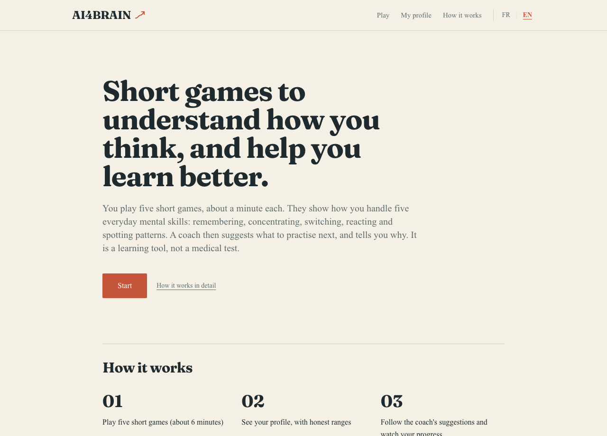

A first-time visitor sees what the app is, the three steps (play five short games, see your profile with honest ranges, follow the coach), an everyday example for each of the five skills further down, and a clear statement that it is not a medical tool. The language switch (FR | EN) is always in the header; the whole interface is translated, including game instructions and coach text.

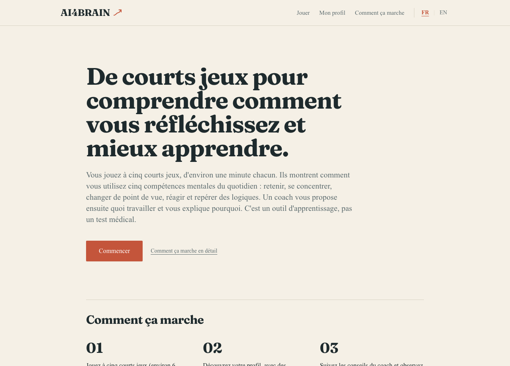

Why it matters: the brief asks for an explainable, non-clinical product that a non-expert can understand. The page uses no diagnostic vocabulary and no jargon. A [How it works](docs/screenshots/desktop_en/02_how_it_works.png) page adds the detail, including what the app is *not*.

### 2. Consent first, with real choices

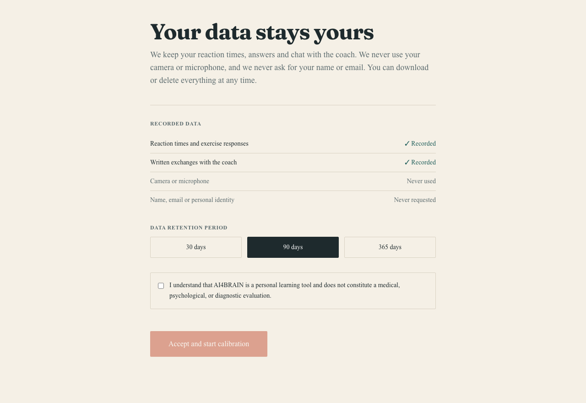

Nothing is stored before consent. The page lists what is recorded (reaction times and answers, exchanges with the coach) and what is never used or requested (camera, microphone, name, e-mail). The player picks a retention period (30, 90 or 365 days) and confirms that this is a learning tool. Without consent, the API rejects any assessment with HTTP 403.

### 3. Before each game: a briefing with an animated example

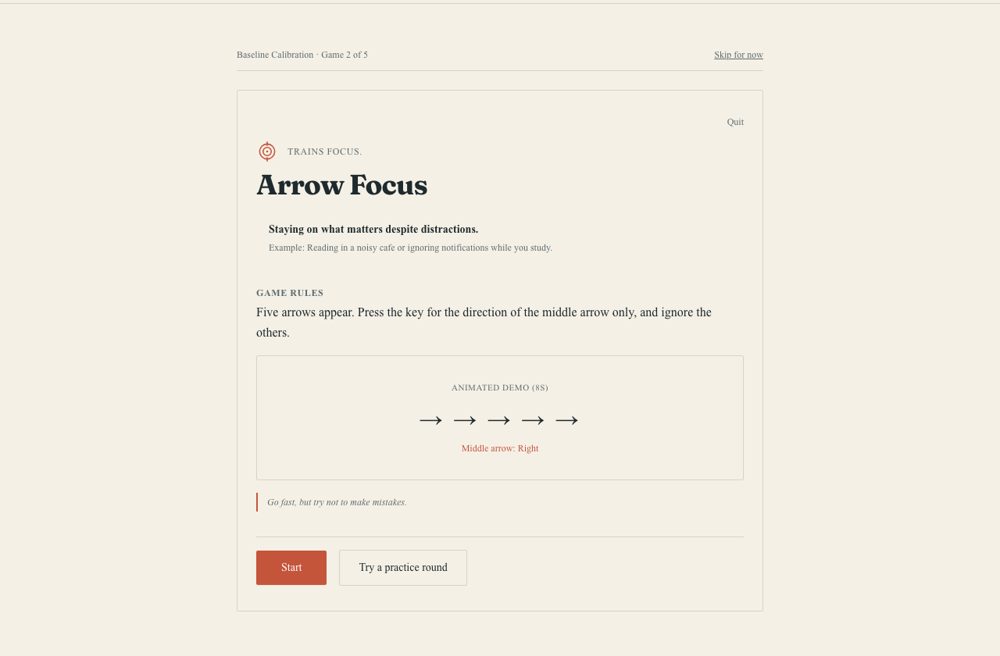

Every game opens with what it trains, an everyday example of that skill, the rules, an 8-second animated demonstration and a tip. First-time players can try a practice round. The same screen in French:

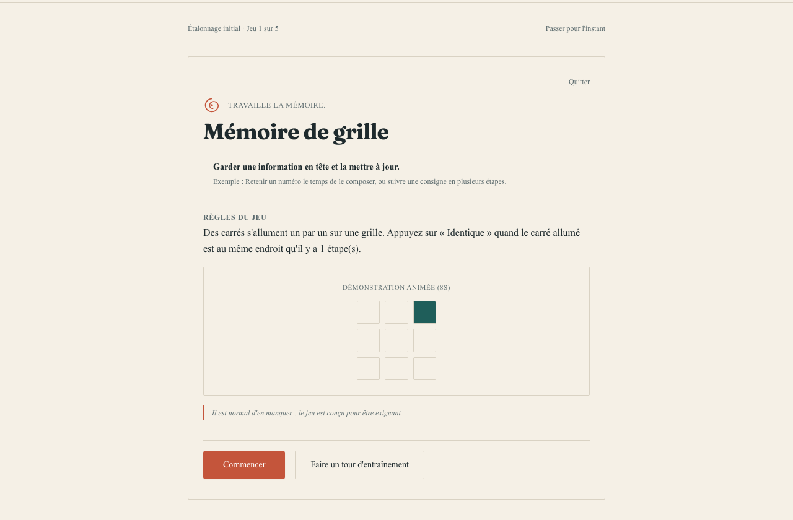

The five games are listed [below](#the-five-games). Each lasts 60 to 90 seconds of scored play and is playable with the keyboard.

### 4. In a game: nothing but the task

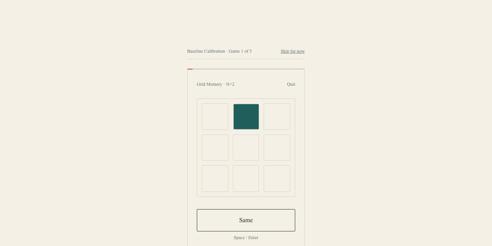

Grid Memory (a spatial n-back): squares light up one at a time and the player presses "Same" when the lit square matches the one from n steps earlier. A thin progress line and a quit link are the only other elements. No score is shown between games during calibration, to avoid anchoring.

### 5. The coach: next step, with a reason

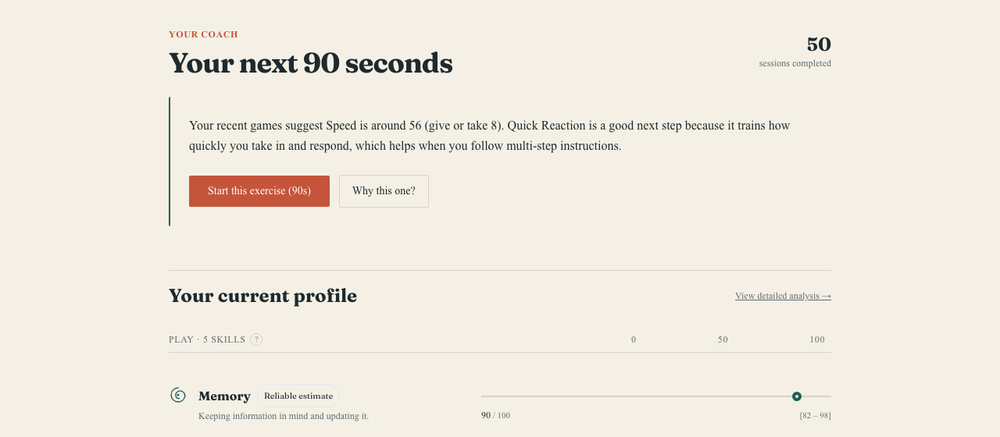

The home page shows one recommendation and one primary action. The text is built from the numbers that actually drove the choice (here: Speed is the skill with the most room to grow and its range is still wide), so it cannot invent a reason. "Why this one?" opens a fuller explanation with an alternative; players can also ask for something else. Estimates always come with their range: "around 56, give or take 8".

### 6. The profile: ranges, not scores

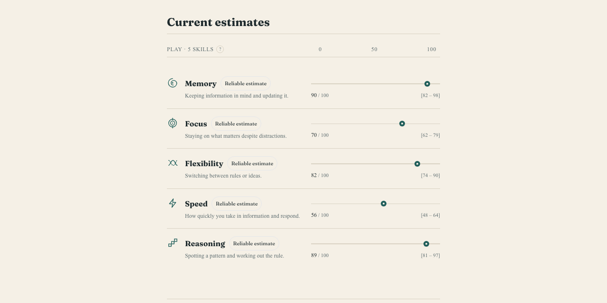

One row per skill. The dot is the best estimate, the bracket is the 95% range, and the label says how reliable it is (early estimate, getting clearer, reliable). A skill that has not been played shows "Not measured yet" and no number. Scores are personal reference points on a 0 to 100 scale: not grades, not an IQ, and not comparisons with other people.

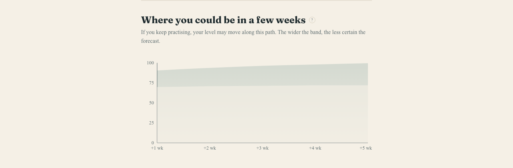

The projection band shows where a skill could go if the player keeps practising. The band widens with time because the future is uncertain. (This chart currently shows the Memory skill only, and the band is clipped at 100 for high estimates.)

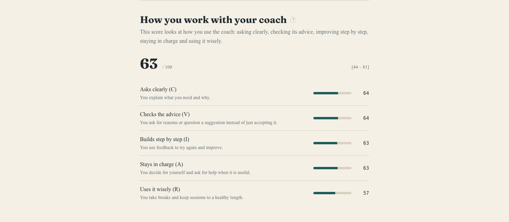

The **AI Collaboration Score** measures how the player works with the coach (asking clearly, checking the advice, building step by step, staying in charge, using it wisely). It is hidden until enough interactions are logged, and a "How is this computed?" help shows the exact formula. Details in [AI Collaboration Score](#ai-collaboration-score).

### 7. Privacy page: download or delete everything

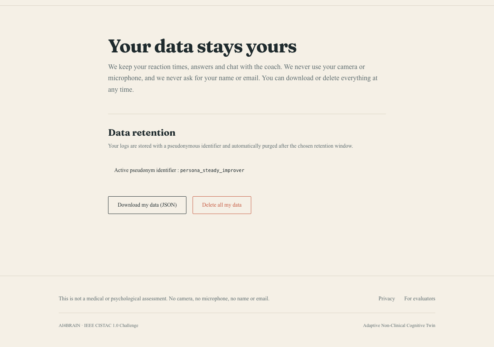

Players can export all their data as JSON or delete it all and receive a receipt. Data is keyed by a random pseudonym, and records past their retention period are purged by a routine endpoint.

### 8. On a phone

<p>
  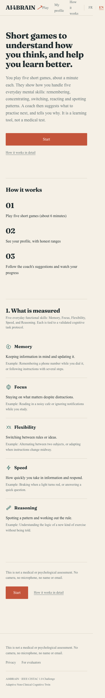
  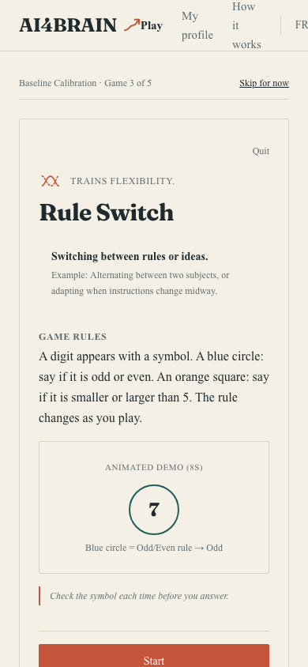
  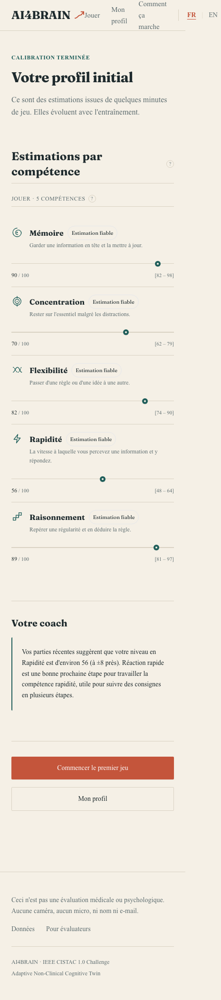
  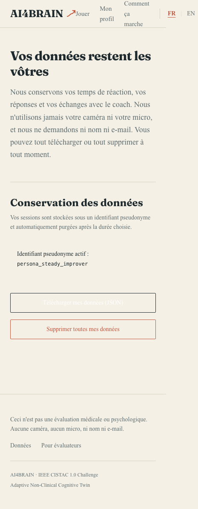
</p>

The layout is a single column at 390 px, in both languages.

---

## What it measures

Five functional skills. They describe how someone performs on short tasks and what they can practise; they are not traits and not clinical categories.

| Skill | Meaning | Everyday example |
|---|---|---|
| Memory | Holding information in mind and updating it | Remembering a phone number while dialling it |
| Focus | Staying on what matters despite distractions | Reading in a noisy café |
| Flexibility | Switching between rules or ideas | Alternating between two subjects |
| Speed | How quickly you take in information and respond | Braking when a light turns red |
| Reasoning | Spotting a pattern and working out the rule | Understanding a new kind of exercise |

## How it works

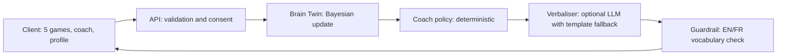

1. The player gives consent and chooses a retention period.
2. Each game sends a structured session payload (reaction times, correctness, difficulty).
3. The Brain Twin updates a Gaussian belief per skill: a best estimate and a 95% range.
4. A deterministic policy picks the next skill and difficulty.
5. The coach turns the decision into a short explanation. A language model can phrase it, but it cannot change the decision. Every sentence is checked before display.

The data contracts are defined once as JSON Schema ([`contracts/schemas.json`](contracts/schemas.json)) and mirrored as Pydantic v2 models ([`backend/app/models/schemas.py`](backend/app/models/schemas.py)) and TypeScript types ([`frontend/src/types/contracts.ts`](frontend/src/types/contracts.ts)).

## The five games

Difficulty is one of five levels (0.5, 0.75, 1, 1.5, 2) and is fixed inside a session. Full protocols and formulas: [`contracts/task_protocols.md`](contracts/task_protocols.md).

| Game | Skill | Trials | Raw score |
|---|---|---|---|
| Grid Memory (spatial n-back, n = 1 to 3) | Memory | 24 | `100·clip(d′ / 3.4)` |
| Arrow Focus (flanker) | Focus | 40 | `100·clip(1 − I/250)·acc_incongruent` |
| Rule Switch (cued task switching) | Flexibility | 36 | `100·clip(1 − SC_rel/0.6)·acc_switch` |
| Quick Reaction (choice RT, 2 to 6 keys) | Speed | 60 | `100·clip((1.6 − rel)/0.9)·acc²` |
| Pattern Puzzle (procedural matrices) | Reasoning | 6 items | `100·clip((p − 1/6)/(5/6))` |

## The Brain Twin model

Each skill is a latent ability θ in [0, 100] that drifts slowly and is observed with noise:

```
θ_t = θ_{t-1} + w,  w ~ N(0, Q)          prior N(50, 25²), Q = 2.5
y   = clip(s·m + 10·log2(d))             s: raw score, d: difficulty, m: speed modifier
R   = (10·√d·(1 + 0.5·e^(−t/3)))²        noisier when harder and in early sessions
K   = P / (P + R),  μ' = μ + K(y − μ),  σ'² = (1 − K)·P,   P = σ² + Q
```

- The speed bonus only applies to accurate responses, so fast guessing earns nothing.
- A session with standardized innovation above 3 (a lapse) inflates the noise, so one bad session barely moves the estimate.
- The drift term keeps uncertainty above zero: the model never claims certainty.
- The profile shows `μ ± 1.96σ`. The projection widens with time: `σ_k² = σ² + 4kQ` (k weeks).

Code: [`backend/app/core/engine.py`](backend/app/core/engine.py).

## The coach

- **Policy** ([`coach_policy.py`](backend/app/core/coach_policy.py)): priority = 0.4·room to grow + 0.4·uncertainty + 0.2·recency. Difficulty moves toward about 70/100 performance.
- **Explanation** ([`coach_prompt.py`](backend/app/core/coach_prompt.py), spec in [`contracts/coach_system_prompt.md`](contracts/coach_system_prompt.md)): built from the same numbers that drove the decision.
- **Guardrail** ([`clinical_guardrails.py`](backend/app/core/clinical_guardrails.py)): rejects diagnostic vocabulary and norm comparisons in English and French. A test runs 200 random traces per language.
- **Offline mode**: without an API key the coach uses a built-in bilingual template. With `ANTHROPIC_API_KEY` set, a language model phrases the explanation (validated, two retries, then template).

## AI Collaboration Score

`Score = 0.20·C + 0.25·V + 0.20·I + 0.20·A + 0.15·R`, each component in [0, 100] from interaction logs, shrunk toward 50 for small samples.

| | Component | Looks at |
|---|---|---|
| C | Clarification | Clear, anchored requests; repairing misunderstandings |
| V | Critical verification | Asking why, challenging with a reason, not accepting blindly |
| I | Iteration | Using feedback to try again and improve |
| A | Autonomy | Balanced use of the coach, deciding for oneself |
| R | Responsible use | Session length, rest after fatigue, no over-use |

Code: [`backend/app/core/ai_collab.py`](backend/app/core/ai_collab.py). The score is hidden until at least 8 interactions and 2 recommendation responses are logged.

## Privacy and ethics

- Pseudonymous id only. No name, e-mail, camera, microphone, face, voice or keystroke dynamics. Non-biometric mode is a constant of the payload schema.
- Consent with a retention period is required before any assessment is accepted.
- Users can download all their data and delete everything with a receipt.
- A purge routine removes records past their retention period (`POST /admin/purge-expired`, protected by `ADMIN_TOKEN`).
- Wording rules: estimates, ranges and "suggests"; no fixed-ability statements; no comparisons with other people.

## Quick start

Requirements: Python 3.9+, Node.js 18+.

```bash
# 1. Backend
cd backend
python3 -m venv .venv && source .venv/bin/activate
pip install -r requirements.txt
PYTHONPATH=. python -m pytest -q          # 19 tests

# 2. Frontend
cd ../frontend
npm install

# 3. Optional configuration
cd ..
cp .env.example .env                       # ANTHROPIC_API_KEY (LLM wording), ADMIN_TOKEN (purge endpoint)

# 4. Run both servers
bash start.sh                              # http://localhost:3000, API on http://localhost:8000
```

Demo personas: open `/demo` (Steady Improver, Variable Responder, Fatigue Pattern), seeded with simulated sessions.
If a page looks stale after editing the frontend, delete `frontend/.next` and restart the dev server.

## API

| Method | Route | Purpose |
|---|---|---|
| POST | `/consent` | Register consent and retention |
| POST | `/assessment` | Submit a game session; returns the updated profile |
| GET | `/brain-twin/{user_id}` | Current profile (estimates, ranges, history, projection) |
| GET | `/coach/recommendation/{user_id}` | Next game with explanation (`language`, `user_action`, ...) |
| POST | `/collab-event/{user_id}` | Log an interaction event |
| GET | `/user/{user_id}/export` | Download all data |
| DELETE | `/user/{user_id}/data` | Hard delete with receipt |
| POST | `/admin/purge-expired` | Purge expired records (header `X-Admin-Token`) |
| GET | `/taxonomy`, `/health` | Skill definitions, health check |

Interactive docs: `http://localhost:8000/docs`.

## Project structure

```
backend/
  app/core/        engine, coach policy and prompt, collaboration score, guardrails, taxonomy
  app/models/      Pydantic v2 contracts
  app/services/    in-memory store, consent, export, deletion, purge, demo personas
  tests/           engine, collaboration score, schemas, API, language check
frontend/src/
  app/             pages: landing, how-it-works, consent, calibration, results, home, profile, demo, privacy
  components/      games, dashboard (range lines, projection), coach, brand, layout
  locales/         en.json, fr.json
contracts/         schemas.json, task_protocols.md, coach_system_prompt.md
docs/              ieee_report/, video/, screenshots/
scripts/           simulation, report figures, screenshots, demo video, i18n checks
```

## Evaluation

Simulation (seed 7): 200 users × 5 skills × 12 sessions, with a generator that differs from the estimator (practice bonus, different noise level, 4% attention lapses).

| Metric | With damping | Without damping |
|---|---|---|
| Posterior SD, sessions 1 / 3 / 12 | 11.9 / 7.1 / 4.1 | same |
| RMSE vs true ability, session 12 | 3.55 | 4.84 |
| Coverage of the 95% range, session 12 | 97.2% | 90.6% |
| Lapses damped / false damping | 82.6% / 0.12% | n/a |
| Correlation, final estimate vs true ability | 0.94 | n/a |

Software: 19 automated tests (engine, collaboration score, schemas, consent gate, export, deletion, purge with a fake clock, bilingual language check). Two scripts check that both locale files have the same keys and that no user-facing text is hard-coded. These results come from simulation; see the [report](docs/ieee_report/AI4BRAIN_report.pdf).

## Reproducing the figures, report, screenshots and video

```bash
python3 scripts/report_figures.py                 # simulation and report data (docs/ieee_report/data)
cd docs/ieee_report && tectonic main.tex          # report (IEEEtran + pgfplots)

cd backend && source .venv/bin/activate           # needs Playwright with Chromium and both servers running
python ../scripts/capture_screenshots.py
python ../scripts/make_demo_video.py              # macOS `say` for narration, ffmpeg for encoding

python3 scripts/verify_i18n_keys.py               # localisation checks
python3 scripts/check_no_hardcoded_literals.py
```

## Limitations

- **No study with real participants yet.** Reliability and coverage figures come from simulation. No usability study has been run.
- One minute of play gives noisy estimates, especially for reasoning (6 items) and difference scores. The ranges are wide on purpose.
- Skills are modelled independently with Gaussian noise. Constants (policy weights, speed coefficient, noise levels) are design choices that need calibration on real data.
- No user authentication: the pseudonymous id acts as a secret for export and deletion. The data store is in memory.
- The bilingual interface was checked automatically, not reviewed by native-speaking users.
- Known rough edges: the home page counts sessions across skills (a demo persona shows "50 sessions"), and the projection chart covers only the Memory skill.
- Demo personas use seeded, simulated data.

## Résumé en français

AI4BRAIN est un outil d'aide à l'apprentissage, non clinique. Cinq courts jeux (environ une minute chacun) estiment cinq compétences du quotidien : mémoire, concentration, flexibilité, rapidité et raisonnement. Chaque estimation est une fourchette qui se resserre avec la pratique. Un coach propose le prochain jeu et explique pourquoi, en français ou en anglais.

- Aucune caméra, aucun micro, ni nom ni e-mail. Consentement et durée de conservation au départ ; export et suppression des données à tout moment.
- Aucun diagnostic, aucune comparaison avec d'autres personnes.
- Parcours en images : voir [A tour of the app](#a-tour-of-the-app). Installation : [Quick start](#quick-start). Rapport : [PDF](docs/ieee_report/AI4BRAIN_report.pdf). Vidéo : [`ai4brain_demo.mp4`](docs/video/ai4brain_demo.mp4).
- Les chiffres de fiabilité viennent de simulations ; aucune étude avec de vrais participants n'a encore été menée.

## License and authors

License: to be defined by the authors. Authors: see the technical report.
