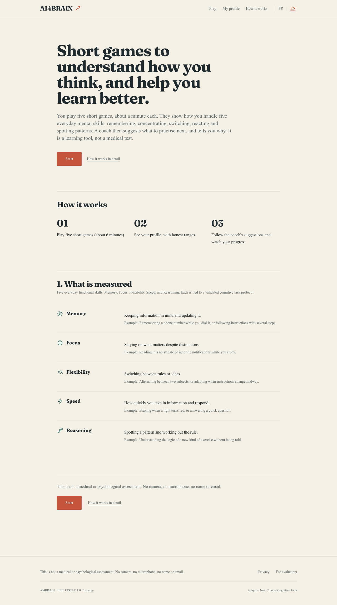
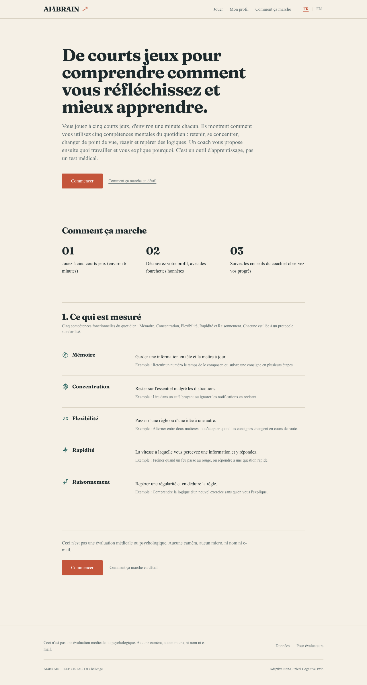
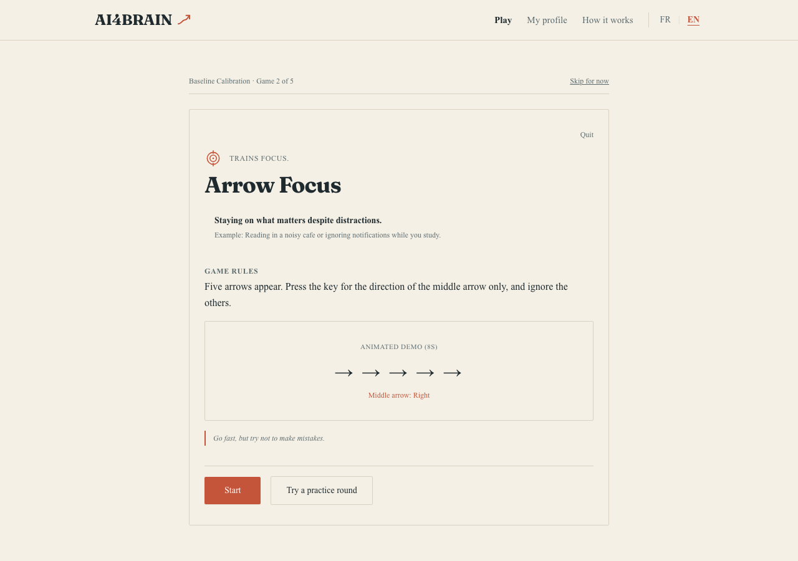
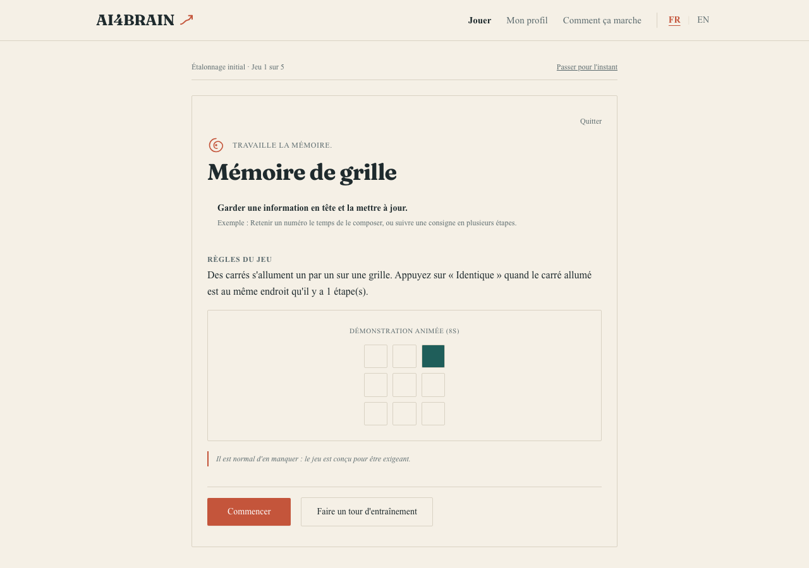
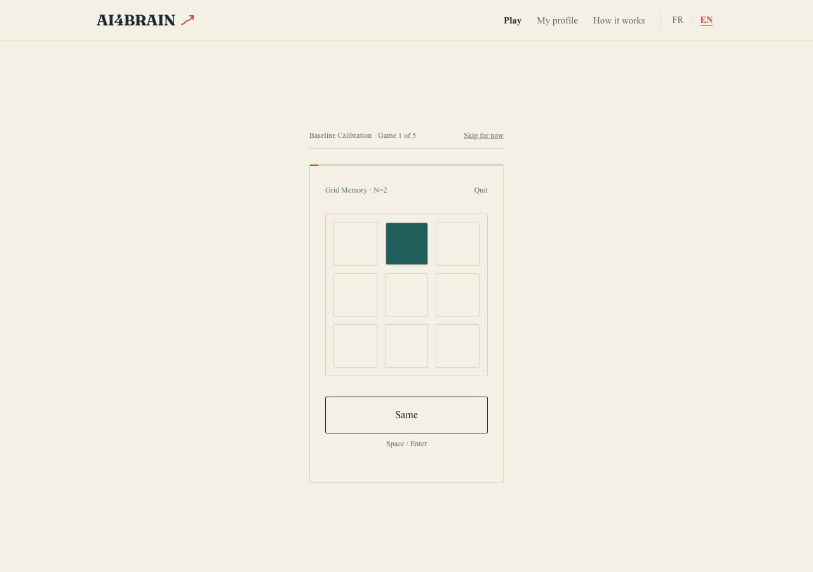
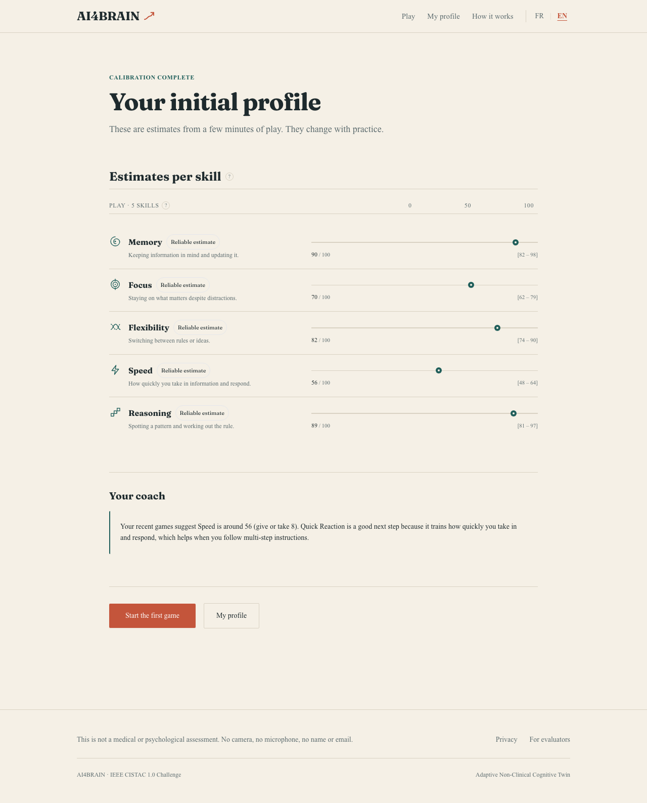
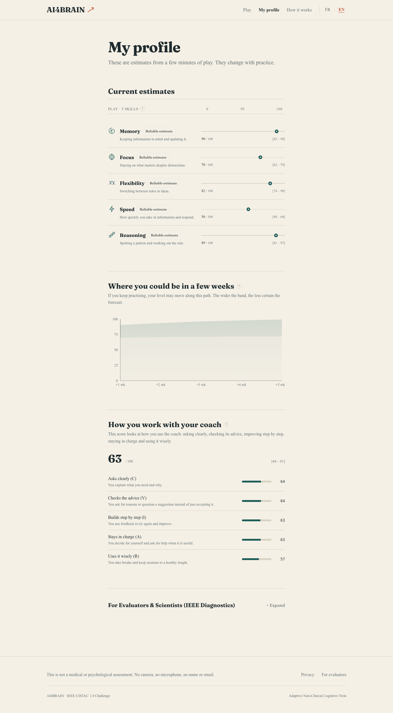
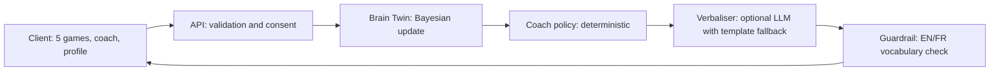

# AI4BRAIN

**An uncertainty-aware, non-clinical cognitive growth agent.**
Entry for the IEEE CISTAC 1.0 challenge (IEEE Computational Intelligence Society, Tunisia Chapter).

Five one-minute games estimate five everyday thinking skills. Each estimate is a range that narrows with practice, never a single "score". A coach recommends the next game and explains why in plain language, in English or French.

> AI4BRAIN is a learning-support tool. It is not a medical or psychological assessment, makes no diagnosis, and never compares a person to others. It uses no camera, no microphone, and asks for no name or e-mail.

| | |
|---|---|
| Technical report (IEEE format, 5 pages) | [`docs/ieee_report/AI4BRAIN_report.pdf`](docs/ieee_report/AI4BRAIN_report.pdf) |
| Demo video (about 4 min, narrated) | [`docs/video/ai4brain_demo.mp4`](docs/video/ai4brain_demo.mp4) |
| Screenshots (FR/EN, desktop/mobile) | [`docs/screenshots/`](docs/screenshots/) |
| Data contracts | [`contracts/`](contracts/) |
| Résumé en français | [see below](#résumé-en-français) |

---

## Contents
1. [Screenshots](#screenshots)
2. [What it measures](#what-it-measures)
3. [How it works](#how-it-works)
4. [The five games](#the-five-games)
5. [The Brain Twin model](#the-brain-twin-model)
6. [The coach](#the-coach)
7. [AI Collaboration Score](#ai-collaboration-score)
8. [Privacy and ethics](#privacy-and-ethics)
9. [Quick start](#quick-start)
10. [API](#api)
11. [Project structure](#project-structure)
12. [Evaluation](#evaluation)
13. [Reproducing the figures, report, screenshots and video](#reproducing-the-figures-report-screenshots-and-video)
14. [Limitations](#limitations)
15. [Résumé en français](#résumé-en-français)

---

## Screenshots

All images are real browser captures (Playwright) of the running app. Profile and results screens use a seeded demo persona (simulated data), not a real person.

### Landing and explanation
<p>
  
  
</p>

### Before each game: briefing with an animated example
<p>
  
  
</p>

### In a game
<p>
  
</p>

### Results: one range line per skill
<p>
  
</p>

### Profile: projection, collaboration score, scientist panel
<p>
  
</p>

### Mobile (390 px)
<p>
  
  
  
  
</p>

More: [how it works](docs/screenshots/desktop_en/02_how_it_works.png) · [consent](docs/screenshots/desktop_en/03_consent.png) · [home](docs/screenshots/desktop_en/07_home_returning_user.png) · [privacy](docs/screenshots/desktop_en/09_privacy.png)

---

## What it measures

Five functional skills. They describe how someone performs on short tasks and what they can practise; they are not traits and not clinical categories.

| Skill | Meaning | Everyday example |
|---|---|---|
| Memory | Holding information in mind and updating it | Remembering a phone number while dialling it |
| Focus | Staying on what matters despite distractions | Reading in a noisy café |
| Flexibility | Switching between rules or ideas | Alternating between two subjects |
| Speed | How quickly you take in information and respond | Braking when a light turns red |
| Reasoning | Spotting a pattern and working out the rule | Understanding a new kind of exercise |

---

## How it works



1. The player gives consent and chooses a retention period (30, 90 or 365 days).
2. Each game sends a structured session payload (reaction times, correctness, difficulty).
3. The Brain Twin updates a Gaussian belief per skill: a best estimate and a 95% range.
4. A deterministic policy picks the next skill and difficulty.
5. The coach turns the decision into a short explanation. A language model can phrase it, but it cannot change the decision. Every sentence is checked before display.

The data contracts are defined once as JSON Schema ([`contracts/schemas.json`](contracts/schemas.json)) and mirrored as Pydantic v2 models ([`backend/app/models/schemas.py`](backend/app/models/schemas.py)) and TypeScript types ([`frontend/src/types/contracts.ts`](frontend/src/types/contracts.ts)).

---

## The five games

Each game lasts 60 to 90 seconds of scored play. Difficulty is one of five levels (0.5, 0.75, 1, 1.5, 2) and is fixed inside a session. Full protocols and formulas: [`contracts/task_protocols.md`](contracts/task_protocols.md).

| Game | Skill | Trials | Raw score |
|---|---|---|---|
| Grid Memory (spatial n-back, n = 1 to 3) | Memory | 24 | `100·clip(d′ / 3.4)` |
| Arrow Focus (flanker) | Focus | 40 | `100·clip(1 − I/250)·acc_incongruent` |
| Rule Switch (cued task switching) | Flexibility | 36 | `100·clip(1 − SC_rel/0.6)·acc_switch` |
| Quick Reaction (choice RT, 2 to 6 keys) | Speed | 60 | `100·clip((1.6 − rel)/0.9)·acc²` |
| Pattern Puzzle (procedural matrices) | Reasoning | 6 items | `100·clip((p − 1/6)/(5/6))` |

Every game starts with a briefing (what it trains, how to play, an 8-second animated example) and can be played with the keyboard.

---

## The Brain Twin model

Each skill is a latent ability θ in [0, 100] that drifts slowly and is observed with noise:

```
θ_t = θ_{t-1} + w,  w ~ N(0, Q)          prior N(50, 25²), Q = 2.5
y   = clip(s·m + 10·log2(d))             s: raw score, d: difficulty, m: speed modifier
R   = (10·√d·(1 + 0.5·e^(−t/3)))²        noisier when harder and in early sessions
K   = P / (P + R),  μ' = μ + K(y − μ),  σ'² = (1 − K)·P,   P = σ² + Q
```

- The speed bonus only applies to accurate responses, so fast guessing earns nothing.
- A session with standardized innovation above 3 (a lapse) inflates the noise, so one bad session barely moves the estimate.
- The drift term keeps uncertainty above zero: the model never claims certainty.
- The profile shows `μ ± 1.96σ`. The projection cone widens with time: `σ_k² = σ² + 4kQ` (k weeks).

Code: [`backend/app/core/engine.py`](backend/app/core/engine.py).

---

## The coach

- **Policy** ([`coach_policy.py`](backend/app/core/coach_policy.py)): priority = 0.4·room to grow + 0.4·uncertainty + 0.2·recency. Difficulty moves toward about 70/100 performance.
- **Explanation** ([`coach_prompt.py`](backend/app/core/coach_prompt.py), prompt spec in [`contracts/coach_system_prompt.md`](contracts/coach_system_prompt.md)): built from the same numbers that drove the decision, so it cannot invent a reason. Users can ask "why", see a counterfactual, or propose another game.
- **Guardrail** ([`clinical_guardrails.py`](backend/app/core/clinical_guardrails.py)): rejects diagnostic vocabulary and norm comparisons in English and French. A test runs 200 random traces per language.
- **Offline mode**: without an API key the coach uses a built-in bilingual template. With `ANTHROPIC_API_KEY` set, a language model phrases the explanation (validated, two retries, then template).

---

## AI Collaboration Score

`Score = 0.20·C + 0.25·V + 0.20·I + 0.20·A + 0.15·R`, each component in [0, 100] from interaction logs, shrunk toward 50 for small samples.

| | Component | Looks at |
|---|---|---|
| C | Clarification | Clear, anchored requests; repairing misunderstandings |
| V | Critical verification | Asking why, challenging with a reason, not accepting blindly |
| I | Iteration | Using feedback to try again and improve |
| A | Autonomy | Balanced use of the coach, deciding for oneself |
| R | Responsible use | Session length, rest after fatigue, no over-use |

Code: [`backend/app/core/ai_collab.py`](backend/app/core/ai_collab.py). The score is hidden until at least 8 interactions and 2 recommendation responses are logged.

---

## Privacy and ethics

- Pseudonymous id only. No name, e-mail, camera, microphone, face, voice or keystroke dynamics. Non-biometric mode is a constant of the payload schema.
- Consent with a retention period is required before any assessment is accepted (HTTP 403 otherwise).
- The privacy page lets users **download all their data** and **delete everything** with a receipt.
- A purge routine removes records past their retention period (`POST /admin/purge-expired`, protected by `ADMIN_TOKEN`).
- Language rules: estimates, ranges and "suggests", never fixed-ability statements, never comparisons with other people.

---

## Quick start

Requirements: Python 3.9+, Node.js 18+.

```bash
# 1. Backend
cd backend
python3 -m venv .venv && source .venv/bin/activate
pip install -r requirements.txt
PYTHONPATH=. python -m pytest -q          # 19 tests

# 2. Frontend
cd ../frontend
npm install

# 3. Optional configuration
cd ..
cp .env.example .env                       # ANTHROPIC_API_KEY (LLM wording), ADMIN_TOKEN (purge endpoint)

# 4. Run both servers
bash start.sh                              # http://localhost:3000, API on http://localhost:8000
```

Demo personas: open `/demo` (Steady Improver, Variable Responder, Fatigue Pattern). They are seeded with simulated sessions.

If a page looks stale after editing the frontend, delete `frontend/.next` and restart the dev server.

---

## API

| Method | Route | Purpose |
|---|---|---|
| POST | `/consent` | Register consent and retention |
| POST | `/assessment` | Submit a game session; returns the updated profile |
| GET | `/brain-twin/{user_id}` | Current profile (estimates, ranges, history, projection) |
| GET | `/coach/recommendation/{user_id}` | Next game with explanation (`language`, `user_action`, ...) |
| POST | `/collab-event/{user_id}` | Log an interaction event |
| GET | `/user/{user_id}/export` | Download all data |
| DELETE | `/user/{user_id}/data` | Hard delete with receipt |
| POST | `/admin/purge-expired` | Purge expired records (header `X-Admin-Token`) |
| GET | `/taxonomy`, `/health` | Skill definitions, health check |

Interactive docs: `http://localhost:8000/docs`.

---

## Project structure

```
backend/
  app/core/        engine.py, coach_policy.py, coach_prompt.py, ai_collab.py, clinical_guardrails.py, taxonomy.json
  app/models/      Pydantic v2 contracts
  app/services/    in-memory store, consent, export, deletion, purge, demo personas
  tests/           engine, collaboration score, schemas, API, language check
frontend/src/
  app/             pages: landing, how-it-works, consent, calibration, results, home, profile, demo, privacy
  components/      games, dashboard (range lines, projection), coach, brand, layout
  locales/         en.json, fr.json
contracts/         schemas.json, task_protocols.md, coach_system_prompt.md
docs/              ieee_report/, video/, screenshots/
scripts/           simulation, report figures, screenshots, demo video, i18n checks
```

---

## Evaluation

Simulation (seed 7): 200 users × 5 skills × 12 sessions, with a generator that differs from the estimator (practice bonus, different noise level, 4% attention lapses).

| Metric | With damping | Without damping |
|---|---|---|
| Posterior SD, sessions 1 / 3 / 12 | 11.9 / 7.1 / 4.1 | same |
| RMSE vs true ability, session 12 | 3.55 | 4.84 |
| Coverage of the 95% range, session 12 | 97.2% | 90.6% |
| Lapses damped / false damping | 82.6% / 0.12% | n/a |
| Correlation, final estimate vs true ability | 0.94 | n/a |

Software: 19 automated tests (engine, collaboration score, schemas, consent gate, export, deletion, purge with a fake clock, bilingual language check). A script checks that both locale files have the same keys and that no user-facing text is hard-coded.

These results come from simulation. See the report for details.

---

## Reproducing the figures, report, screenshots and video

```bash
# Simulation and report data (docs/ieee_report/data)
python3 scripts/report_figures.py

# Report (needs tectonic or a LaTeX distribution with IEEEtran and pgfplots)
cd docs/ieee_report && tectonic main.tex

# Screenshots and demo video (need Playwright with Chromium, both servers running)
cd backend && source .venv/bin/activate
python ../scripts/capture_screenshots.py
python ../scripts/make_demo_video.py       # macOS `say` for the narration, ffmpeg for encoding

# Localisation checks
python3 scripts/verify_i18n_keys.py
python3 scripts/check_no_hardcoded_literals.py
```

---

## Limitations

- **No study with real participants yet.** Reliability and coverage figures come from simulation. No usability study has been run.
- One minute of play gives noisy estimates, especially for reasoning (6 items) and difference scores. The ranges are wide on purpose.
- Skills are modelled independently with Gaussian noise. Constants (policy weights, speed coefficient, noise levels) are design choices that need calibration on real data.
- No user authentication: the pseudonymous id acts as a secret for export and deletion. The data store is in memory.
- The bilingual interface was checked automatically, not reviewed by native-speaking users.
- Demo personas use seeded, simulated data.

---

## Résumé en français

AI4BRAIN est un outil d'aide à l'apprentissage, non clinique. Cinq courts jeux (environ une minute chacun) estiment cinq compétences du quotidien : mémoire, concentration, flexibilité, rapidité et raisonnement. Chaque estimation est une fourchette qui se resserre avec la pratique. Un coach propose le prochain jeu et explique pourquoi, en français ou en anglais.

- Aucune caméra, aucun micro, ni nom ni e-mail. Consentement et durée de conservation au départ ; export et suppression des données à tout moment.
- Aucun diagnostic, aucune comparaison avec d'autres personnes.
- Installation : voir [Quick start](#quick-start). Rapport : [`docs/ieee_report/AI4BRAIN_report.pdf`](docs/ieee_report/AI4BRAIN_report.pdf). Vidéo : [`docs/video/ai4brain_demo.mp4`](docs/video/ai4brain_demo.mp4).
- Les chiffres de fiabilité viennent de simulations ; aucune étude avec de vrais participants n'a encore été menée.

---

## License and authors

License: to be defined by the authors. Authors: see the technical report.
